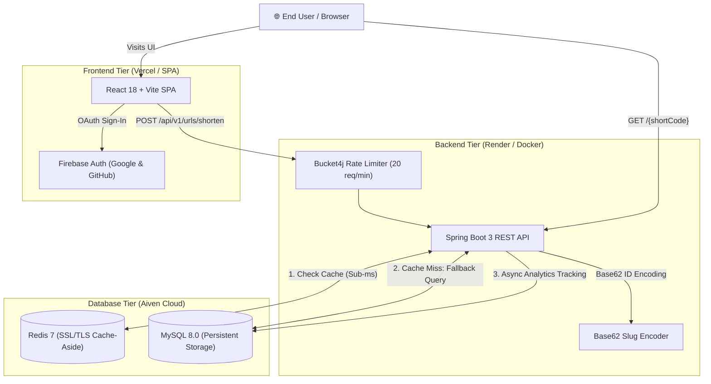

# 🔗 SnapLink — Cloud-Native High-Performance URL Shortener

[](https://openjdk.org/projects/jdk/21/)
[](https://spring.io/projects/spring-boot)
[](https://react.dev/)
[](https://vitejs.dev/)
[](https://www.docker.com/)
[](https://www.mysql.com/)
[](https://redis.io/)
[](https://firebase.google.com/)
[](LICENSE)

**SnapLink** is an enterprise-grade, full-stack URL shortening and link management platform. Built with a high-throughput **Spring Boot 3** backend and a reactive **React / Vite** frontend, it leverages **Redis** as a Cache-Aside layer for sub-millisecond HTTP 302 redirects, **MySQL** for durable link persistence, **Bucket4j** for token-bucket rate limiting, and **Firebase Authentication** for Google and GitHub OAuth.

---

## 🏗️ System Architecture



---

## ✨ Features

- **⚡ Sub-Millisecond Redirects:** High-performance HTTP 302 redirects powered by Redis Cache-Aside caching with automatic cache invalidation upon link updates.
- **✦ Custom Slugs & Collision Prevention:** Generate compact Base62 slugs or define custom branded aliases with atomic collision checks.
- **▦ Dynamic QR Codes:** Instant client-side QR code generation and download for every shortened link.
- **◉ Comprehensive Click Analytics:** Detailed access metrics recording total clicks, access timestamps, client IP addresses, user agents, and HTTP referrers.
- **🛡️ Token-Bucket Rate Limiting:** Endpoint-level protection powered by Bucket4j (20 requests/minute per client IP) on link generation.
- **🔐 Modern OAuth Authentication:** Seamless sign-in via Google and GitHub powered by Firebase Authentication with persistent session handling.
- **☁️ Multi-Cloud Deployment Ready:** Pre-configured for deployment across Render (Dockerized backend), Aiven (Managed MySQL + Redis with SSL/TLS), and Vercel (Single Page Application).

---

## 🛠️ Tech Stack

| Layer | Technology | Details |
|---|---|---|
| **Backend** | Java 21, Spring Boot 3.2.5 | Spring MVC, Spring Data JPA, Hibernate, Bucket4j |
| **Caching** | Redis 7.0 | Spring Data Redis, Lettuce Client with SSL/TLS |
| **Database** | MySQL 8.0 | InnoDB, Automatic DDL schema migration via Hibernate |
| **Frontend** | React 18, Vite 5, React Router 7 | Modern dark-mode UI, custom SVG icons, Canvas QR generation |
| **Auth** | Firebase Authentication | Google OAuth, GitHub OAuth, Email/Password |
| **Reverse Proxy** | Nginx Alpine | Production SPA routing & API reverse proxy |
| **Containers** | Docker & Docker Compose | Multi-stage Eclipse Temurin 21 production builds |

---

## 📡 API Reference

### 1. Shorten a URL
Creates a shortened URL with an auto-generated or custom alias.
```http
POST /api/v1/urls/shorten
Content-Type: application/json

{
  "originalUrl": "https://github.com/rishabhgjr10/Snaplink",
  "customAlias": "snaplink-repo"
}
```
**Response (200 OK):**
```json
{
  "success": true,
  "message": "URL shortened",
  "data": {
    "shortCode": "snaplink-repo",
    "shortUrl": "http://localhost:8080/snaplink-repo",
    "originalUrl": "https://github.com/rishabhgjr10/Snaplink"
  },
  "status": 200
}
```

### 2. Redirect to Original URL
Resolves the short code and redirects the browser.
```http
GET /{shortCode}
```
**Response:** `HTTP/1.1 302 Found` with `Location: <originalUrl>`

### 3. List All URLs
```http
GET /api/v1/urls
```
**Response (200 OK):**
```json
{
  "success": true,
  "message": "URLs retrieved",
  "data": [
    {
      "shortCode": "snaplink-repo",
      "shortUrl": "http://localhost:8080/snaplink-repo",
      "originalUrl": "https://github.com/rishabhgjr10/Snaplink",
      "createdAt": "2026-10-16T14:30:00Z",
      "totalClicks": 42
    }
  ],
  "status": 200
}
```

### 4. Fetch Link Analytics
```http
GET /api/v1/urls/{shortCode}/analytics
```
**Response (200 OK):**
```json
{
  "success": true,
  "message": "Analytics fetched",
  "data": {
    "totalClicks": 42,
    "recentVisits": [
      {
        "id": 1,
        "shortCode": "snaplink-repo",
        "accessedAt": "2026-10-16T15:10:00Z",
        "ipAddress": "192.168.1.1",
        "userAgent": "Mozilla/5.0 ...",
        "referer": "https://google.com"
      }
    ]
  },
  "status": 200
}
```

### 5. Update a Shortened URL
```http
PUT /api/v1/urls/{shortCode}
Content-Type: application/json

{
  "originalUrl": "https://new-destination.com",
  "customAlias": "updated-slug"
}
```

### 6. Delete a Shortened URL
```http
DELETE /api/v1/urls/{shortCode}
```

---

## 🚀 Getting Started (Local Development)

### Prerequisites
- [Docker & Docker Compose](https://www.docker.com/)
- [Java 21 JDK](https://adoptium.net/) (for local backend development without Docker)
- [Node.js 20+](https://nodejs.org/) (for frontend development)

### Quickstart with Docker Compose

1. **Clone the repository:**
   ```bash
   git clone https://github.com/rishabhgjr10/Snaplink.git
   cd Snaplink
   ```

2. **Start all services:**
   ```bash
   docker-compose up -d
   ```

3. **Access the application:**
   - **Frontend UI:** [http://localhost:5173](http://localhost:5173)
   - **Backend API:** [http://localhost:8080](http://localhost:8080)
   - **MySQL:** `localhost:3307` (user: `root`, password: `rootpassword`)
   - **Redis:** `localhost:6379`

---

## ☁️ Cloud Deployment Guide

SnapLink is engineered to run in a decoupled, cloud-native topology:

```
┌────────────────────────┐      ┌─────────────────────────┐      ┌─────────────────────────┐
│     Vercel (SPA)       │ ───> │     Render (Docker)     │ ───> │  Aiven (MySQL + Redis)  │
│  React 18 / Vite 5     │      │   Java 21 / Spring Boot │      │   Managed Cloud DBs     │
└────────────────────────┘      └─────────────────────────┘      └─────────────────────────┘
```

### 1. Database & Cache: Aiven
1. Create an **Aiven for MySQL** service (database: `defaultdb`, SSL Mode: `REQUIRED`).
2. (Optional) Create an **Aiven for Redis** service with SSL enabled.

### 2. Backend Web Service: Render
1. Create a new **Web Service** on [Render](https://render.com) pointing to this repository.
2. Select **Docker** environment (Render automatically uses the multi-stage [`Dockerfile`](Dockerfile)).
3. Configure Environment Variables:
   | Variable | Value | Description |
   |---|---|---|
   | `SPRING_DATASOURCE_URL` | `jdbc:mysql://<aiven-host>:<port>/defaultdb?sslMode=REQUIRED` | Aiven MySQL JDBC connection |
   | `SPRING_DATASOURCE_USERNAME` | `avnadmin` | MySQL username |
   | `SPRING_DATASOURCE_PASSWORD` | `<your-aiven-mysql-password>` | MySQL password |
   | `SPRING_REDIS_HOST` | `<your-aiven-redis-host>` | Redis host |
   | `SPRING_REDIS_PORT` | `<your-aiven-redis-port>` | Redis port |
   | `SPRING_REDIS_PASSWORD` | `<your-aiven-redis-password>` | Redis password |
   | `SPRING_REDIS_SSL` | `true` | Enables TLS for Aiven Redis |
   | `APP_BASE_URL` | `https://<your-render-service>.onrender.com` | Base domain for short link redirects |
   | `CORS_ALLOWED_ORIGINS` | `http://localhost:5173,https://*.vercel.app,https://<your-domain>.vercel.app` | Allowed origins |
   | `SPRING_PROFILES_ACTIVE` | `prod` | Activates production profile |

### 3. Frontend SPA: Vercel
1. Import this repository into [Vercel](https://vercel.com).
2. Set **Root Directory** to `frontend`.
3. Set Framework Preset to **Vite**.
4. Configure Environment Variables:
   | Variable | Value |
   |---|---|
   | `VITE_API_URL` | `https://<your-render-service>.onrender.com` |
   | `VITE_BACKEND_URL` | `https://<your-render-service>.onrender.com` |
   | `VITE_FIREBASE_API_KEY` | `<your-firebase-api-key>` |
   | `VITE_FIREBASE_AUTH_DOMAIN` | `<your-project>.firebaseapp.com` |
   | `VITE_FIREBASE_PROJECT_ID` | `<your-project-id>` |
   | `VITE_FIREBASE_STORAGE_BUCKET` | `<your-project>.firebasestorage.app` |
   | `VITE_FIREBASE_MESSAGING_SENDER_ID` | `<your-sender-id>` |
   | `VITE_FIREBASE_APP_ID` | `<your-app-id>` |

SPA catch-all routing is pre-configured via [`frontend/vercel.json`](frontend/vercel.json).

---

## 📁 Repository Structure

```text
Snaplink/
├── .gitignore                     # Production Git ignore rules
├── Dockerfile                     # Multi-stage Temurin 21 backend Dockerfile
├── docker-compose.yml             # Local orchestration (MySQL, Redis, Backend, Frontend)
├── pom.xml                        # Maven dependencies & build configuration
├── README.md                      # Project documentation
├── backend/
│   └── Dockerfile                 # Cloud deployment Dockerfile alias
├── src/                           # Spring Boot 3 Java source
│   ├── main/
│   │   ├── java/com/example/shortener/
│   │   │   ├── UrlShortenerApplication.java
│   │   │   ├── config/            # Redis SSL, Bucket4j RateLimiter, CORS, Async
│   │   │   ├── controller/        # UrlController (/api/v1/urls), RedirectController (/{code})
│   │   │   ├── dto/               # Request & Response DTOs
│   │   │   ├── entity/            # JPA Entities (UrlEntity, UrlAnalytics)
│   │   │   ├── repository/        # Spring Data JPA Repositories
│   │   │   ├── service/           # UrlService & Implementation with Cache-Aside
│   │   │   └── util/              # Base62 encoder & ApiResponse wrapper
│   │   └── resources/
│   │       ├── application.properties      # Cloud-parameterized configuration
│   │       └── application-dev.properties  # Dev H2 in-memory profile
│   └── test/                              # Unit & integration tests
└── frontend/                      # React 18 + Vite SPA
    ├── .env.example               # Cloud environment variable reference
    ├── Dockerfile                 # Multi-stage Node 20 to Nginx Alpine Dockerfile
    ├── nginx.conf                 # SPA routing & local /api reverse proxy
    ├── package.json               # Frontend dependencies & scripts
    ├── vercel.json                # Vercel SPA catch-all rewrites
    ├── vite.config.js             # Vite development server configuration
    └── src/
        ├── components/            # AnalyticsPanel, EditModal, LinkRow, Logo, QR codes
        ├── context/               # AuthContext (Firebase Google/GitHub OAuth)
        ├── layouts/               # MainLayout (NavBar & Footer)
        ├── lib/                   # firebase.js initialization
        ├── pages/                 # LandingPage, Dashboard, Login, Signup
        └── services/              # api.js API client layer
```

---

## 📄 License

This project is licensed under the [MIT License](LICENSE).

---

## 👨‍💻 Author

**Rishabh Gurjar**
- GitHub: [@rishabhgjr10](https://github.com/rishabhgjr10)
- Repository: [https://github.com/rishabhgjr10/Snaplink](https://github.com/rishabhgjr10/Snaplink)