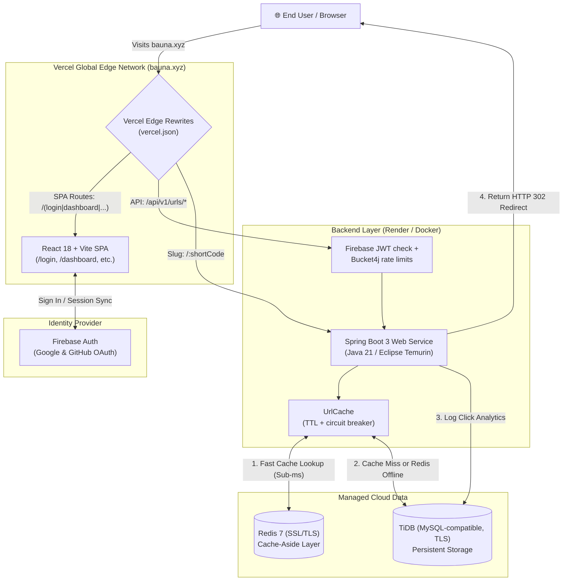

# 🔗 SnapLink (bauna.xyz) — High-Performance URL Shortener & QR Studio

[](https://bauna.xyz)
[](https://snaplink-sd0r.onrender.com)
[](LICENSE)

[](https://openjdk.org/projects/jdk/21/)
[](https://spring.io/projects/spring-boot)
[](https://react.dev/)
[](https://vitejs.dev/)
[-4479A1.svg?logo=mysql)](https://www.pingcap.com/tidb/)
[-DC382D.svg?logo=redis)](https://redis.io/)
[-FFCA28.svg?logo=firebase)](https://firebase.google.com/)
[](https://www.docker.com/)

> **Live Production URL:** [https://bauna.xyz](https://bauna.xyz)  
> **API Gateway & Redirection:** [https://bauna.xyz/:shortCode](https://bauna.xyz) → [Render Backend](https://snaplink-sd0r.onrender.com)

**SnapLink** is an enterprise-grade, full-stack URL shortening, link management, and custom QR code platform engineered with **Java 21 / Spring Boot 3**, **React 18 / Vite**, **TiDB (MySQL-compatible)**, and **Redis**. It features zero-CORS edge proxy routing via **Vercel Edge Rewrites**, sub-millisecond HTTP 302 redirects with resilient cache fallback, Google and GitHub OAuth authentication via **Firebase**, and a full-featured **QR Code Studio** for creating high-resolution, branded QR codes.

---

## 🌟 Key Features

### ⚡ Ultra-Short Custom Domain Routing
- Generates clean, branded short links via our custom domain: `https://bauna.xyz/<alias>`
- Choose between random 7-character codes or case-sensitive custom aliases.
- Destinations are validated (http/https only, no self-links, optional domain blocklist and Google Safe Browsing).

### 🌐 Edge Proxy Architecture (Zero CORS Overhead)
- Powered by Vercel edge rewrites ([`frontend/vercel.json`](frontend/vercel.json)) matching routes at the network edge.
- Client SPA pages (`/dashboard`, `/login`, etc.) serve instantaneously from Vercel's global CDN.
- Short-code slugs (`bauna.xyz/:shortCode`) and API requests (`/api/*`) proxy directly to the Spring Boot backend on Render, returning native HTTP 302 redirects with zero browser-side round trips.

### 🎨 Interactive QR Code Studio
- In-browser visual QR customizer with real-time constrained preview.
- **Dot Patterns:** Blocks, Smooth, Circles, Diamond, D.Smooth, Bubbles.
- **Styling:** Custom corner squares, corner dots, background/foreground hex colors, linear/radial gradients, and logo embedding.
- **Error Correction:** Adjustable levels (L: 7%, M: 15%, Q: 25%, H: 30% damage tolerance).
- **High-Res Export:** Direct client-side generation of PNG, JPG, and scalable SVG up to **2048px**.

### 🔐 OAuth 2.0 & Firebase Authentication
- Seamless social login with **Google** and **GitHub** popup authentication alongside email/password credentials.
- The backend verifies Firebase ID tokens on every request; each user can only see and change their own links.

### 🛡️ Fault-Tolerant Caching & Persistence
- Low-latency cache layer with **Spring Data Redis (Lettuce)** over SSL/TLS.
- **Resilient Fallback Design:** `UrlCache` uses Redis when configured, with a TTL on every entry and a circuit breaker: after a Redis failure it switches to a bounded in-memory cache for 30 seconds instead of making every redirect wait. Cache writes happen only after the database transaction commits.

### 📊 Link Analytics & Management
- Privacy-respecting click tracking: total clicks, clicks per hour, recent visits with device type and referring site. IPs are truncated, bots and link previews are not counted, and records expire after 365 days.
- Edit destination or alias without losing click history; abuse reports with admin takedown.
- Rate limiting with **Bucket4j** on every API route: per user when signed in, per client IP otherwise, plus a shared cap on anonymous writes.

---

## 🏗️ System Architecture & Data Flow



---

## 🛠️ Tech Stack Details

| Layer | Technologies & Services | Details |
|---|---|---|
| **Custom Domain** | `bauna.xyz` via Namecheap DNS | Directed to Vercel edge servers with automatic SSL/TLS |
| **Frontend** | React 18, Vite 5, Tailwind CSS | Deployed on **Vercel** with edge rewrites, React Router 7, Canvas QR |
| **Backend** | Java 21, Spring Boot 3.2.5 | Deployed on **Render** (Docker containerized), Spring Data JPA, Bucket4j |
| **Database** | TiDB (MySQL-compatible) | TLS connections; schema managed by Flyway migrations |
| **Cache Layer** | Aiven for Redis 7.0 | Lettuce driver with SSL/TLS, Cache-Aside pattern, fault-tolerant fail-open |
| **Authentication** | Firebase Authentication | Google OAuth, GitHub OAuth, token-based session management |
| **Containerization** | Docker & Docker Compose | Multi-stage build on `eclipse-temurin:21-jre-jammy` with container memory flags |

---

## 🚦 Edge Routing Rules (`frontend/vercel.json`)

Vercel acts as an intelligent edge reverse proxy, routing traffic according to these prioritized rules:

| Priority | Source Pattern | Target Destination | Purpose |
|:---:|---|---|---|
| `1` | `/api/:path*` | `https://snaplink-sd0r.onrender.com/api/:path*` | Proxies API calls directly to Render with no CORS restrictions |
| `2` | `/(login\|signup\|dashboard\|...)` | `/index.html` | Serves client-side React routes without triggering backend lookups |
| `3` | `/assets/:path*` | `/assets/:path*` | Serves static JS, CSS, and image bundles from Vite |
| `4` | `/:shortCode` | `https://snaplink-sd0r.onrender.com/:shortCode` | Proxies short links to Spring Boot for instant HTTP 302 redirection |
| `5` | `/(.*)` | `/index.html` | Fallback catch-all for SPA navigation |

---

## 📡 REST API Reference

Base URL: `https://bauna.xyz/api/v1` (same-origin through the Vercel rewrite).

**Authentication.** Endpoints marked 🔒 need a Firebase ID token: `Authorization: Bearer <token>`.
The backend verifies the signature, issuer, audience (`FIREBASE_PROJECT_ID`) and expiry.
Links belong to the signed-in user who created them; another user's link behaves exactly like a missing one (`404`).

**Errors** always use the same envelope: `{"success": false, "message": "...", "status": <code>}`
(`400` invalid input, `401` not signed in, `403` not allowed, `404` not found, `409` alias taken, `410` link disabled, `429` rate limited).

| Method | Path | Auth | Purpose |
|---|---|---|---|
| `POST` | `/api/v1/urls/shorten` | optional | Create a link (owned by the caller when signed in) |
| `GET` | `/api/v1/urls?page=0&size=25&q=&status=all&sort=newest` | 🔒 | Caller's links with click counts and status. `status`: `all`, `active`, `scheduled`, `expired`; `sort`: `newest`, `expiring` |
| `GET` | `/api/v1/urls/summary` | 🔒 | `totalLinks`, `totalClicks`, `activeLinks`, `expiredLinks` |
| `PUT` | `/api/v1/urls/{shortCode}` | 🔒 | Change destination, alias, expiry, start time or click limit (click history is kept) |
| `DELETE` | `/api/v1/urls/{shortCode}` | 🔒 | Delete a link and its click history |
| `DELETE` | `/api/v1/urls?status=expired` | 🔒 | Delete all of the caller's expired links |
| `GET` | `/api/v1/urls/{shortCode}/analytics` | 🔒 | Total clicks, clicks per UTC hour today, last 10 visits |
| `GET` | `/api/v1/me` | 🔒 | Caller's UID and admin flag |
| `POST` | `/api/v1/reports` | optional | Report an abusive link |
| `GET` | `/api/v1/admin/reports?status=OPEN` | 🔒 admin | Review reports |
| `POST` | `/api/v1/admin/reports/{id}/resolve?status=RESOLVED&disableLink=true` | 🔒 admin | Resolve or dismiss a report |
| `POST` | `/api/v1/admin/urls/{shortCode}/disable` · `/enable` | 🔒 admin | Take a link down or restore it |
| `GET` | `/api/v1/health` | — | Lightweight liveness check (used to wake Render) |
| `GET` | `/{shortCode}` | — | `302` to the destination; otherwise a short explanation page: `404` unknown, `410` expired / click limit reached / disabled, `403` not active yet |

### Create a link
```http
POST /api/v1/urls/shorten
Content-Type: application/json

{ "originalUrl": "https://github.com/rishabhgjr10/Snaplink", "customAlias": "snaplink-repo" }
```
```json
{ "success": true, "message": "URL shortened", "data": { "shortCode": "snaplink-repo", "originalUrl": "https://github.com/rishabhgjr10/Snaplink" }, "status": 200 }
```
Rules: only `http://` and `https://` destinations; no embedded credentials (`https://a.com@b.com`); no links to SnapLink itself or to blocked domains.
Aliases are 3–32 characters of `A–Z a–z 0–9 - _`, case-sensitive, and may not be a reserved word (`login`, `dashboard`, `api`, …).
Without an alias a random 7-character code is generated.

### Link lifetime
Optional fields on create (and on update):

| Field | Meaning |
|---|---|
| `expiresAt` | ISO-8601 time the link stops working (5 minutes to 365 days ahead). Omit for no expiry. |
| `startsAt` | ISO-8601 time the link starts working. Before it, visitors see a "not active yet" page. |
| `maxClicks` | Stop after this many human clicks (1–1,000,000). Bots and repeat clicks within 30 s don't count. |

On update, `clearExpiresAt`, `clearStartsAt` and `clearMaxClicks` remove a limit; a new expiry or a higher click limit reactivates a stopped link.
Links created without signing in always expire after at most 30 days (the default), and are deleted 30 days after they expire, which frees their alias.
Links that belong to an account are never deleted automatically.

### Analytics
```json
{
  "success": true,
  "data": {
    "totalClicks": 128,
    "clicksTodayByHour": [0, 0, 3, "… 24 values …"],
    "recentVisits": [{ "visitedAt": "2026-11-22T09:45:00Z", "referrer": "https://news.ycombinator.com", "device": "mobile" }]
  },
  "status": 200
}
```
Visitor IP addresses and user agents are never returned. Bots and link-preview fetchers are not counted, and a repeat click from the same visitor within 30 seconds counts once.

---

## 💻 Local Development & Setup

### Prerequisites
- [Git](https://git-scm.com/)
- [Java 21 JDK](https://adoptium.net/) (Eclipse Temurin recommended)
- [Node.js 20+](https://nodejs.org/) & `npm`
- [Docker](https://www.docker.com/) (for Docker Compose and for the backend integration tests)

### Method A: Docker Compose
```bash
docker compose up --build -d
```
- Frontend: `http://localhost:5173` · Backend: `http://localhost:8080`
- MySQL on `127.0.0.1:3307` and Redis on `127.0.0.1:6379` (local-only). Set `LOCAL_MYSQL_PASSWORD`, `LOCAL_MYSQL_ROOT_PASSWORD` and `LOCAL_REDIS_PASSWORD` in a `.env` file to replace the local defaults.

### Method B: Maven + Vite
Backend with the `dev` profile (in-memory H2 database, no Redis needed):
```bash
SPRING_PROFILES_ACTIVE=dev mvn spring-boot:run
```
Frontend (create `frontend/.env` from `frontend/.env.example` and fill in the Firebase values):
```bash
cd frontend
npm install
npm run dev
```

### Tests
```bash
mvn verify            # unit tests + MySQL integration tests (needs Docker)
cd frontend && npm run typecheck && npm test && npm run build
```
CI runs the same commands on every push and pull request (`.github/workflows/ci.yml`).

### Database migrations
The schema is managed by Flyway (`src/main/resources/db/migration`). Existing databases are baselined at version 1 on first start, then later versions run automatically. Never edit a migration that has already run; add a new `V<n>__description.sql` instead.

---

## ☁️ Production Deployment Variables

### 1. Render (backend)
| Variable | Required | Value |
|---|---|---|
| `SPRING_DATASOURCE_URL` | yes | `jdbc:mysql://<tidb-host>:4000/<db>?sslMode=VERIFY_IDENTITY` |
| `SPRING_DATASOURCE_USERNAME` | yes | database user |
| `SPRING_DATASOURCE_PASSWORD` | yes | database password |
| `APP_BASE_URL` | yes | `https://bauna.xyz` |
| `APP_ADMIN_UIDS` | recommended | Firebase UIDs of moderators, comma separated |
| `FIREBASE_PROJECT_ID` | no (default `snapliink`) | Firebase project whose tokens are accepted |
| `SPRING_REDIS_HOST` / `_PORT` / `_PASSWORD` / `_SSL` | no | Redis for shared cache and rate limits; omit to use in-memory |
| `CORS_ALLOWED_ORIGINS` | no | Exact origins only (default `http://localhost:5173,https://bauna.xyz,https://www.bauna.xyz`) |
| `RATE_LIMIT_TRUSTED_PROXY_HOPS` | no (default `1`) | Proxies in front of the app that append to `X-Forwarded-For` |
| `APP_BLOCKED_DOMAINS` | no | Destination domains to refuse |
| `SAFE_BROWSING_API_KEY` | no | Enables Google Safe Browsing checks on new links |
| `ANALYTICS_RETENTION_DAYS` | no (default `365`) | Click records older than this are deleted daily |
| `SENTRY_DSN` | no | Error tracking |
| `SPRING_PROFILES_ACTIVE` | no (default `prod`) | `prod` enables JSON logs |

Health probes: `/actuator/health/liveness`, `/actuator/health/readiness`.

### 2. Vercel (frontend)
| Variable | Required | Value |
|---|---|---|
| `VITE_FIREBASE_API_KEY`, `VITE_FIREBASE_AUTH_DOMAIN`, `VITE_FIREBASE_PROJECT_ID`, `VITE_FIREBASE_APP_ID` | yes | From the Firebase console |
| `VITE_FIREBASE_STORAGE_BUCKET`, `VITE_FIREBASE_MESSAGING_SENDER_ID` | no | From the Firebase console |
| `VITE_API_URL` | no | Leave empty: the API is reached same-origin through `vercel.json` |
| `VITE_BACKEND_URL` | no | Short-link origin; defaults to the site origin |
| `VITE_SENTRY_DSN` | no | Error tracking |

`vercel.json` also sets security headers. The Content-Security-Policy is shipped in **report-only** mode: check the browser console for violations, then rename the header to `Content-Security-Policy` to enforce it.

---

## 📂 Project Structure

```text
Snaplink/
├── Dockerfile                         # Backend image (Temurin 21)
├── docker-compose.yml                 # Local stack (MySQL, Redis, backend, frontend)
├── pom.xml
├── .github/workflows/ci.yml           # Backend + frontend checks
├── src/main/java/com/example/shortener/
│   ├── config/                        # Security (Firebase JWT), CORS, rate limiting, Redis, errors
│   ├── controller/                    # Url, Redirect, Report, Admin, Health
│   ├── dto/                           # Request/response records
│   ├── entity/                        # UrlEntity, UrlAnalytics, LinkReport
│   ├── exception/                     # Typed API errors
│   ├── repository/
│   ├── security/                      # CurrentUser, ClientIpResolver
│   └── service/                       # UrlService, UrlPolicy, UrlCache, ClickRecorder, ...
├── src/main/resources/db/migration/   # Flyway migrations
├── src/test/                          # Unit + Testcontainers integration tests
└── frontend/
    ├── vercel.json                    # Rewrites + security headers
    └── src/
        ├── components/dashboard/      # Sidebar, LinksTab, AnalyticsTab, CreateLinkPanel, ...
        ├── hooks/                     # useLinks, useBackendStatus, useToast
        ├── pages/                     # Landing, Dashboard, Admin, Report, Login, Signup, Privacy, Terms
        ├── services/api.ts            # Typed API client
        └── styles/global.css
```

---

## 📄 License

This project is licensed under the [MIT License](LICENSE).

---

## 👨‍💻 Author

**Rishabh Gurjar**
- GitHub: [@rishabhgjr10](https://github.com/rishabhgjr10)
- Repository: [https://github.com/rishabhgjr10/Snaplink](https://github.com/rishabhgjr10/Snaplink)
- Live Platform: [https://bauna.xyz](https://bauna.xyz)