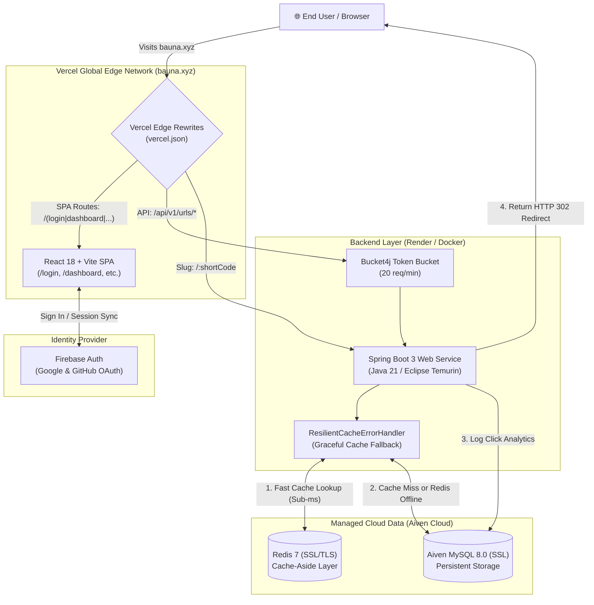

# 🔗 SnapLink (bauna.xyz) — High-Performance URL Shortener & QR Studio

[](https://bauna.xyz)
[](https://snaplink-backend-3rk3.onrender.com)
[](LICENSE)

[](https://openjdk.org/projects/jdk/21/)
[](https://spring.io/projects/spring-boot)
[](https://react.dev/)
[](https://vitejs.dev/)
[-4479A1.svg?logo=mysql)](https://aiven.io/)
[-DC382D.svg?logo=redis)](https://redis.io/)
[-FFCA28.svg?logo=firebase)](https://firebase.google.com/)
[](https://www.docker.com/)

> **Live Production URL:** [https://bauna.xyz](https://bauna.xyz)  
> **API Gateway & Redirection:** [https://bauna.xyz/:shortCode](https://bauna.xyz) → [Render Backend](https://snaplink-backend-3rk3.onrender.com)

**SnapLink** is an enterprise-grade, full-stack URL shortening, link management, and custom QR code platform engineered with **Java 21 / Spring Boot 3**, **React 18 / Vite**, **Aiven Managed MySQL**, and **Redis**. It features zero-CORS edge proxy routing via **Vercel Edge Rewrites**, sub-millisecond HTTP 302 redirects with resilient cache fallback, Google and GitHub OAuth authentication via **Firebase**, and a full-featured **QR Code Studio** for creating high-resolution, branded QR codes.

---

## 🌟 Key Features

### ⚡ Ultra-Short Custom Domain Routing
- Generates clean, branded short links via our custom domain: `https://bauna.xyz/<alias>`
- Choose between compact auto-generated Base62 slugs or custom aliases.
- Configurable link expiration options (`5m`, `1h`, `24h`, `7d`, `30d`, or permanent).

### 🌐 Edge Proxy Architecture (Zero CORS Overhead)
- Powered by Vercel edge rewrites ([`frontend/vercel.json`](frontend/vercel.json)) matching routes at the network edge.
- Client SPA pages (`/dashboard`, `/login`, etc.) serve instantaneously from Vercel's global CDN.
- Short-code slugs (`bauna.xyz/:shortCode`) and API requests (`/api/*`) proxy directly to the Spring Boot backend on Render, returning native HTTP 302 redirects with zero browser-side round trips.

### 🎨 Interactive QR Code Studio
- In-browser visual QR customizer with real-time constrained preview.
- **Dot Patterns:** Blocks, Smooth, Circles, Diamond, D.Smooth, Bubbles.
- **Styling:** Custom corner squares, corner dots, background/foreground hex colors, linear/radial gradients, and logo embedding.
- **Error Correction:** Adjustable levels (L: 7%, M: 15%, Q: 25%, H: 30% damage tolerance).
- **High-Res Export:** Direct client-side generation of PNG, JPG, and scalable SVG up to **2048px**.

### 🔐 OAuth 2.0 & Firebase Authentication
- Seamless social login with **Google** and **GitHub** popup authentication alongside email/password credentials.
- Client session persistence using Firebase Auth state synchronization with protected dashboard routes.

### 🛡️ Fault-Tolerant Caching & Persistence
- Low-latency cache layer with **Spring Data Redis (Lettuce)** over SSL/TLS.
- **Resilient Fallback Design:** All cache operations implement graceful try-catch degradation (`ResilientCacheErrorHandler`). If Redis is unavailable or undergoing maintenance, requests silently fall through to SSL-enforced **Aiven MySQL** without dropping traffic or throwing 500 errors.

### 📊 Link Analytics & Management
- Real-time visit tracking: click counter, timestamps, client IP address, user agent, and referrer URL.
- Active/pause link state toggling, password protection, and OpenGraph preview metadata support.
- In-memory client rate limiting powered by **Bucket4j** (20 requests/minute per client IP) on creation endpoints.

---

## 🏗️ System Architecture & Data Flow



---

## 🛠️ Tech Stack Details

| Layer | Technologies & Services | Details |
|---|---|---|
| **Custom Domain** | `bauna.xyz` via Namecheap DNS | Directed to Vercel edge servers with automatic SSL/TLS |
| **Frontend** | React 18, Vite 5, Tailwind CSS | Deployed on **Vercel** with edge rewrites, React Router 7, Canvas QR |
| **Backend** | Java 21, Spring Boot 3.2.5 | Deployed on **Render** (Docker containerized), Spring Data JPA, Bucket4j |
| **Database** | Aiven for MySQL 8.0 | Managed MySQL with SSL mode (`REQUIRED`), Hibernate DDL auto-updates |
| **Cache Layer** | Aiven for Redis 7.0 | Lettuce driver with SSL/TLS, Cache-Aside pattern, fault-tolerant fail-open |
| **Authentication** | Firebase Authentication | Google OAuth, GitHub OAuth, token-based session management |
| **Containerization** | Docker & Docker Compose | Multi-stage build on `eclipse-temurin:21-jre-jammy` with container memory flags |

---

## 🚦 Edge Routing Rules (`frontend/vercel.json`)

Vercel acts as an intelligent edge reverse proxy, routing traffic according to these prioritized rules:

| Priority | Source Pattern | Target Destination | Purpose |
|:---:|---|---|---|
| `1` | `/api/:path*` | `https://snaplink-backend-3rk3.onrender.com/api/:path*` | Proxies API calls directly to Render with no CORS restrictions |
| `2` | `/(login\|signup\|dashboard\|...)` | `/index.html` | Serves client-side React routes without triggering backend lookups |
| `3` | `/assets/:path*` | `/assets/:path*` | Serves static JS, CSS, and image bundles from Vite |
| `4` | `/:shortCode` | `https://snaplink-backend-3rk3.onrender.com/:shortCode` | Proxies short links to Spring Boot for instant HTTP 302 redirection |
| `5` | `/(.*)` | `/index.html` | Fallback catch-all for SPA navigation |

---

## 📡 REST API Reference

Base Production URL: `https://bauna.xyz/api/v1` (or backend direct: `https://snaplink-backend-3rk3.onrender.com/api/v1`)

### 1. Shorten a URL
```http
POST /api/v1/urls/shorten
Content-Type: application/json

{
  "originalUrl": "https://github.com/rishabhgjr10/Snaplink",
  "customAlias": "snaplink-repo"
}
```
**Response (200 OK):**
```json
{
  "success": true,
  "message": "URL shortened",
  "data": {
    "shortCode": "snaplink-repo",
    "shortUrl": "https://bauna.xyz/snaplink-repo",
    "originalUrl": "https://github.com/rishabhgjr10/Snaplink"
  },
  "status": 200
}
```

### 2. Follow Redirect (HTTP 302)
```http
GET /:shortCode
```
**Response:** `HTTP/1.1 302 Found` with header `Location: <originalUrl>`

### 3. List All Shortened URLs
```http
GET /api/v1/urls
```
**Response (200 OK):**
```json
{
  "success": true,
  "message": "URLs retrieved",
  "data": [
    {
      "shortCode": "snaplink-repo",
      "shortUrl": "https://bauna.xyz/snaplink-repo",
      "originalUrl": "https://github.com/rishabhgjr10/Snaplink",
      "createdAt": "2026-10-17T21:00:00Z",
      "totalClicks": 128
    }
  ],
  "status": 200
}
```

### 4. Fetch Link Analytics
```http
GET /api/v1/urls/{shortCode}/analytics
```
**Response (200 OK):**
```json
{
  "success": true,
  "message": "Analytics fetched",
  "data": {
    "totalClicks": 128,
    "recentVisits": [
      {
        "id": 1,
        "shortCode": "snaplink-repo",
        "accessedAt": "2026-10-17T21:45:00Z",
        "ipAddress": "192.168.1.1",
        "userAgent": "Mozilla/5.0 ...",
        "referer": "https://google.com"
      }
    ]
  },
  "status": 200
}
```

### 5. Update a Shortened URL
```http
PUT /api/v1/urls/{shortCode}
Content-Type: application/json

{
  "originalUrl": "https://new-destination.com",
  "customAlias": "new-slug"
}
```

### 6. Delete a Shortened URL
```http
DELETE /api/v1/urls/{shortCode}
```

---

## 💻 Local Development & Setup

### Prerequisites
- [Git](https://git-scm.com/)
- [Java 21 JDK](https://adoptium.net/) (Eclipse Temurin recommended)
- [Node.js 20+](https://nodejs.org/) & `npm`
- [Docker & Docker Compose](https://www.docker.com/) (optional, for containerized local stack)

---

### Method A: Quickstart with Docker Compose

1. **Clone the repository:**
   ```bash
   git clone https://github.com/rishabhgjr10/Snaplink.git
   cd Snaplink
   ```

2. **Start the complete stack (MySQL, Redis, Backend, Frontend):**
   ```bash
   docker-compose up --build -d
   ```

3. **Verify endpoints:**
   - Frontend UI: `http://localhost:5173`
   - Backend API: `http://localhost:8080`
   - MySQL: `localhost:3307` (user: `root`, password: `rootpassword`)
   - Redis: `localhost:6379`

---

### Method B: Native Local Development (Maven + Vite)

#### 1. Configure Backend (`src/main/resources/application.properties` or `.env`)
You can use a local MySQL/Redis instance or point to cloud credentials:
```properties
# Spring Datasource
spring.datasource.url=jdbc:mysql://localhost:3306/urlshortener?createDatabaseIfNotExist=true&useSSL=false&allowPublicKeyRetrieval=true
spring.datasource.username=root
spring.datasource.password=your_mysql_password

# Spring Redis
spring.data.redis.host=localhost
spring.data.redis.port=6379
spring.data.redis.password=
spring.data.redis.ssl.enabled=false

# App Base Redirect Domain
app.base-url=http://localhost:8080
cors.allowed-origins=http://localhost:5173,https://bauna.xyz,https://*.bauna.xyz,https://*.vercel.app
```

Run the Spring Boot application:
```bash
./mvnw clean spring-boot:run
# On Windows:
mvnw.cmd clean spring-boot:run
```

#### 2. Configure Frontend (`frontend/.env`)
Create `frontend/.env` using `frontend/.env.example` as a template:
```env
# API Gateway Endpoint
VITE_API_URL=http://localhost:8080

# Firebase Configuration
VITE_FIREBASE_API_KEY=AIzaSy...
VITE_FIREBASE_AUTH_DOMAIN=snapliink.firebaseapp.com
VITE_FIREBASE_PROJECT_ID=snapliink
VITE_FIREBASE_STORAGE_BUCKET=snapliink.firebasestorage.app
VITE_FIREBASE_MESSAGING_SENDER_ID=1025901795798
VITE_FIREBASE_APP_ID=1:1025901795798:web:...
```

Install dependencies and start the Vite dev server:
```bash
cd frontend
npm install
npm run dev
```
Open `http://localhost:5173` in your browser.

---

## ☁️ Production Deployment Variables

### 1. Render (Backend Docker Web Service)
| Environment Variable | Recommended Production Value |
|---|---|
| `SPRING_DATASOURCE_URL` | `jdbc:mysql://<aiven-host>:<port>/defaultdb?sslMode=REQUIRED` |
| `SPRING_DATASOURCE_USERNAME` | `avnadmin` |
| `SPRING_DATASOURCE_PASSWORD` | `<your-aiven-mysql-password>` |
| `SPRING_REDIS_HOST` | `<your-aiven-redis-host>` |
| `SPRING_REDIS_PORT` | `<your-aiven-redis-port>` |
| `SPRING_REDIS_PASSWORD` | `<your-aiven-redis-password>` |
| `SPRING_REDIS_SSL` | `true` |
| `APP_BASE_URL` | `https://bauna.xyz` |
| `CORS_ALLOWED_ORIGINS` | `https://bauna.xyz,https://*.bauna.xyz,https://*.vercel.app,http://localhost:5173` |
| `SPRING_PROFILES_ACTIVE` | `prod` |

### 2. Vercel (Frontend SPA)
| Environment Variable | Production Value |
|---|---|
| `VITE_API_URL` | `https://snaplink-backend-3rk3.onrender.com` |
| `VITE_FIREBASE_API_KEY` | `<your-firebase-api-key>` |
| `VITE_FIREBASE_AUTH_DOMAIN` | `snapliink.firebaseapp.com` |
| `VITE_FIREBASE_PROJECT_ID` | `snapliink` |
| `VITE_FIREBASE_STORAGE_BUCKET` | `snapliink.firebasestorage.app` |
| `VITE_FIREBASE_MESSAGING_SENDER_ID` | `1025901795798` |
| `VITE_FIREBASE_APP_ID` | `<your-firebase-app-id>` |

---

## 📂 Project Structure

```text
Snaplink/
├── Dockerfile                         # Production multi-stage Temurin 21 backend build
├── docker-compose.yml                 # Local dev orchestration (MySQL, Redis, App, UI)
├── pom.xml                            # Maven dependencies & build configuration
├── README.md                          # Production architecture documentation
├── src/                               # Spring Boot 3 Java Backend
│   ├── main/
│   │   ├── java/com/example/shortener/
│   │   │   ├── UrlShortenerApplication.java
│   │   │   ├── config/                # RedisConfig (SSL), ResilientCacheErrorHandler, CorsConfig, RateLimiterFilter
│   │   │   ├── controller/            # UrlController (/api/v1/urls), RedirectController (/{shortCode})
│   │   │   ├── dto/                   # UrlShortenRequest, UrlShortenResponse, AnalyticsDTO
│   │   │   ├── entity/                # UrlEntity, UrlAnalytics (JPA entities)
│   │   │   ├── repository/            # UrlRepository, UrlAnalyticsRepository
│   │   │   ├── service/               # UrlServiceImpl (Cache-Aside + Fail-Open MySQL fallback)
│   │   │   └── util/                  # Base62Util, ApiResponse wrapper
│   │   └── resources/
│   │       ├── application.properties # Parameterized production configuration
│   │       └── application-dev.properties
│   └── test/                          # Unit & integration tests
└── frontend/                          # React 18 + Vite SPA
    ├── .env.example                   # Reference environment configuration
    ├── package.json                   # Dependencies: Firebase, qr-code-styling, react-router-dom
    ├── vercel.json                    # Edge proxy & SPA rewrite engine
    ├── vite.config.js                 # Vite bundler & dev proxy
    └── src/
        ├── components/                # QRCodeModal (Portal Studio), LinkRow, AnalyticsPanel
        ├── context/                   # AuthContext.jsx (Firebase Google & GitHub OAuth)
        ├── lib/                       # firebase.js (Firebase Auth client SDK)
        ├── pages/                     # LandingPage, Dashboard, Login, Signup
        └── services/                  # api.js (Axios client)
```

---

## 📄 License

This project is licensed under the [MIT License](LICENSE).

---

## 👨‍💻 Author

**Rishabh Gurjar**
- GitHub: [@rishabhgjr10](https://github.com/rishabhgjr10)
- Repository: [https://github.com/rishabhgjr10/Snaplink](https://github.com/rishabhgjr10/Snaplink)
- Live Platform: [https://bauna.xyz](https://bauna.xyz)